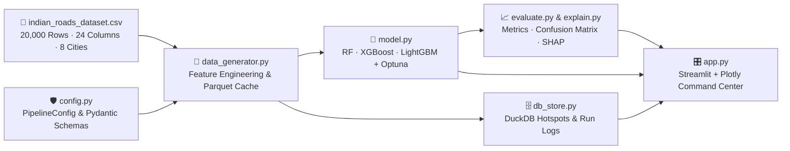

# 🚦 RARIF Framework v2 — Road Accident Risk Intelligence & Forecasting 🛣️📊

> **Pre-accident road risk intelligence, explainable AI, telemetry storage, and interactive decision-support dashboard** engineered on **20,000 Indian road accident records (2022–2025)** across **8 major Indian cities** (*Pune, Mumbai, Chandigarh, Chennai, Delhi, Bangalore, Hyderabad, Kolkata*).

Instead of analyzing only post-crash outcomes, **RARIF Framework v2** models **pre-incident road geometry, traffic density, weather, visibility, cyclical temporal patterns, seasonal context, festival indicators, and primary risk causes** to predict risk tiers (**Low**, **Medium**, **High**), compute a **0–100 Composite Risk Index**, rank **SHAP risk drivers**, and persist analytical tables in **DuckDB**.

---

## 🗺️ System Architecture & Data Flow 🌐⚙️



### 🔄 End-to-End Execution Pipeline
```text
  [Raw CSV: 20k × 24] ──▶ [Pydantic & Feature Eng.] ──▶ [Parquet Cache + 80/20 Split]
                                                               │
         ┌─────────────────────────────────────────────────────┴─────────────────────┐
         ▼                                                                           ▼
  [Model Benchmark + Optuna]                                              [DuckDB Analytics Store]
  (RF · XGBoost · LightGBM)                                             (model_runs · hotspots)
         │                                                                           │
         ▼                                                                           │
  [Evaluate + SHAP Drivers] ────────────────────────────────────────────────────────┤
         │                                                                           │
         └──────────────────────────────────────────▶ [Streamlit + Plotly Command Center] ◀┘
```

---

## 📂 Dataset & Pre-Accident Risk Formulation 🇮🇳🛣️

### 📌 Dataset Profile (`data/indian_roads_dataset.csv`)
| Dimension | Specification |
| :--- | :--- |
| **📦 Dataset Scale** | **20,000 rows** × **24 raw columns** spanning **2022–2025** |
| **🏙️ Cities Covered (8)** | **Pune**, **Mumbai**, **Chandigarh**, **Chennai**, **Delhi**, **Bangalore**, **Hyderabad**, **Kolkata** *(with state & lat/lon coordinates)* |
| **🕒 Temporal Signals** | `date`, `month`, `hour`, `day_of_week`, `is_weekend`, `is_peak_hour` |
| **🛣️ Road & Traffic** | `road_type` (`highway`, `urban`, `rural`), `lanes`, `traffic_signal`, `traffic_density` (`low`, `medium`, `high`) |
| **🌦️ Environment & Context** | `weather` (`clear`, `rain`, `fog`), `visibility` (`high`, `medium`, `low`), `temperature`, `cause` (`overspeeding`, `weather`, `distraction`, `drunk driving`, `poor road`), `festival` |
| **🎯 Risk Target** | Continuous `risk_score` $\rightarrow$ 3 ordinal risk tiers: **Low (`0`)**, **Medium (`1`)**, **High (`2`)** |

### 🔒 Anti-Leakage & Target Construction
* **🎯 Risk Tier Thresholds:** Derived from pre-accident `risk_score` into **🟢 Low (`0`)** (`< 0.35`), **🟡 Medium (`1`)** (`0.35–0.65`), and **🔴 High (`2`)** (`> 0.65`).
* **🛡️ Zero Post-Crash Leakage:** Post-accident outcome fields (`accident_severity`, `casualties`, `vehicles_involved`) and raw `risk_score` are strictly excluded from model feature spaces (`NUMERIC_FEATURES` + `CATEGORICAL_FEATURES`) and verified by unit tests.
* **⚙️ Feature Engineering (`data_generator.py`):**
  * 🏮 Normalizes missing `festival` values to `"None"`.
  * 🌦️ Maps calendar months into Indian seasons (`Winter`, `Summer`, `Monsoon`, `Post-Monsoon`).
  * 🕰️ Applies cyclical encoding (`hour_sin`, `hour_cos`) so midnight transitions smoothly (`23` $\rightarrow$ `0`) and flags late-night/early-morning risk windows (`high_risk_hour`).
  * ⚡ Caches processed features to `artifacts/processed_features.parquet` (supports `--no-cache` for fresh computation).

---

## 🏆 Model Benchmarks & Performance Comparison 🤖📈

Evaluated on a stratified **4,000-sample test split**:

| Model | Test Accuracy | Macro F1 | Weighted F1 | Role |
| :--- | :---: | :---: | :---: | :--- |
| **🥇 XGBoost (`xgboost`)** | **94.73%** | **0.9266** | **0.9461** | **Selected Best Model** |
| **🥈 XGBoost Optuna (`xgboost_optuna`)** | 94.70% | 0.9264 | 0.9459 | Optuna + StratifiedKFold Tuned |
| **🥉 Random Forest (`random_forest`)** | 94.53% | 0.9238 | 0.9440 | Tree-Ensemble Baseline |
| **⚡ LightGBM (`lightgbm`)** | 94.30% | 0.9213 | 0.9419 | Gradient-Boosting Baseline |

### 📊 Relative Accuracy & Macro F1 Comparison Chart

```text
Test Accuracy (%)
XGBoost (Best)  | ████████████████████████████████████████████████ 94.73%
XGBoost Optuna  | ███████████████████████████████████████████████  94.70%
Random Forest   | ██████████████████████████████████████████████   94.53%
LightGBM        | █████████████████████████████████████████████    94.30%

Macro F1 Score (x100)
XGBoost (Best)  | ██████████████████████████████████████████████   92.66
XGBoost Optuna  | ██████████████████████████████████████████████   92.64
Random Forest   | █████████████████████████████████████████████    92.38
LightGBM        | ████████████████████████████████████████████     92.13
```

### 🎯 Class-Level Metrics (`xgboost`)
| Tier | Precision | Recall | F1-Score | Support |
| :--- | :---: | :---: | :---: | :---: |
| **🟢 Low (`0`)** | `0.9252` | `0.9986` | `0.9605` | `1,387` |
| **🟡 Medium (`1`)** | `0.9547` | `0.9491` | `0.9519` | `2,199` |
| **🔴 High (`2`)** | `1.0000` | `0.7657` | `0.8673` | `414` |

---

## 🔍 SHAP Explainability & Top Risk Drivers 🧠✨

`explain.py` computes **Mean `|SHAP|`** values to quantify each feature's contribution to model risk predictions:

```text
Top Risk Drivers (Mean |SHAP|)
visibility_low       | ████████████████████████████████████████████ 1.3957
weather_clear        | ████████████████████████                     0.7605
traffic_density_high | ████████████████████████                     0.7547
is_peak_hour         | ███████████████████████                      0.7219
traffic_density_low  | ███                                          0.0974
weather_fog          | ███                                          0.0847
```

1. **🔦 `visibility_low` (`1.3957`):** Primary risk amplifier during fog, heavy rain, or poor lighting.
2. **🌤️ `weather_clear` (`0.7605`):** Strong baseline contrast against adverse weather conditions.
3. **🚗 `traffic_density_high` (`0.7547`):** Heavy congestion elevates braking and lane-conflict risk.
4. **⏱️ `is_peak_hour` (`0.7219`):** Commuter rush windows shift risk probabilities upward.
5. **🛣️ `traffic_density_low` (`0.0974`):** Lower traffic density baseline modifier.

---

## 🏙️ City-Wise Test Performance 🇮🇳📍

| City | Test Samples | Accuracy | Macro F1 | Visual Accuracy Bar |
| :--- | :---: | :---: | :---: | :--- |
| **Kolkata** | 505 | **96.24%** | 0.9462 | `████████████████████` |
| **Chandigarh** | 492 | **96.14%** | 0.9430 | `████████████████████` |
| **Delhi** | 476 | **95.80%** | 0.9470 | `███████████████████░` |
| **Bangalore** | 480 | **95.21%** | 0.9377 | `███████████████████░` |
| **Mumbai** | 516 | **94.38%** | 0.9149 | `██████████████████░░` |
| **Chennai** | 541 | **93.90%** | 0.9089 | `██████████████████░░` |
| **Hyderabad** | 485 | **93.61%** | 0.9208 | `█████████████████░░░` |
| **Pune** | 505 | **92.67%** | 0.8909 | `█████████████████░░░` |

---

## 🗄️ DuckDB Persistence & Command-Center Dashboard 🎛️📉

* **🗄️ DuckDB Telemetry (`db_store.py`):** Persists experiment runs (`model_runs`) and synchronizes `city_hotspots` and `hourly_hotspots` tables in `artifacts/rarif.duckdb` using atomic `CREATE OR REPLACE TABLE` statements to prevent tuple-deletion conflicts across Streamlit reruns.
* **🎛️ Interactive Dashboard (`app.py`):** Provides a **0–100 Composite Risk Index gauge**, preset scenarios, **What-If counterfactual baseline delta**, **factor sensitivity analysis**, **actionable safety advisories**, **corridor & hourly hotspot charts**, **geospatial scatter visualization**, **SHAP & model diagnostics**, and **JSON/CSV report exports**.

---

## 📁 Repository Structure 🗂️

```text
RARIF-Framework/
├── 📁 data/
│   └── indian_roads_dataset.csv      # 20,000 records across 8 Indian cities (2022–2025)
├── 📁 artifacts/
│   └── best_model.joblib             # Saved best estimator + preprocessor + metrics
├── 📁 outputs/
│   ├── classification_report.txt     # Classification metrics report
│   ├── confusion_matrix.png          # Test confusion matrix plot
│   ├── shap_summary.png              # SHAP summary chart
│   ├── city_metrics.csv              # City-level evaluation metrics
│   └── top_shap_features.csv         # Ranked SHAP feature table
├── 📁 tests/
│   ├── conftest.py                   # Pytest path setup
│   └── test_pipeline.py              # Leakage, feature engineering & Pydantic tests
├── 📄 config.py                         # PipelineConfig & PredictionInput schemas
├── 📄 data_generator.py                 # Feature engineering, Parquet cache & split
├── 📄 db_store.py                       # DuckDB logging & hotspot tables
├── 📄 model.py                          # Training, Optuna tuning & model artifact I/O
├── 📄 evaluate.py                       # Evaluation & visualization outputs
├── 📄 explain.py                        # SHAP explainability generator
├── 📄 main.py                           # End-to-end CLI pipeline entry point
├── 📄 app.py                            # Streamlit + Plotly dashboard
├── 📄 requirements.txt                  # Python dependencies
├── 📄 .gitignore                        # Ignored cache, venv & local DB files
└── 📄 README.md                         # Project documentation
```

---

## ⚡ Local Setup, Testing & Execution 🚀

### 1️⃣ Install Dependencies & Run Tests
```bash
pip install -r requirements.txt
python -m pytest -v
```

### 2️⃣ Run Training, Evaluation, DuckDB Sync & SHAP
```bash
python main.py --model xgboost --trials 10
```
*Optional CLI flags:* `--model` (`xgboost`, `lightgbm`, `random_forest`), `--trials`, `--no-cache`, `--skip-shap`.

### 3️⃣ Launch Streamlit Dashboard
```bash
streamlit run app.py
```

---

## 👨‍💻 Author ✨

**Pushkar Sharma** (`@pushkars17`) — BCA (Hons.) in AI & Data Analytics
